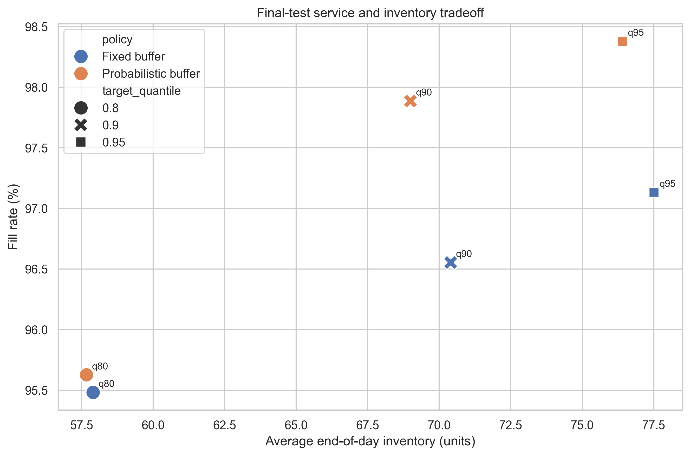
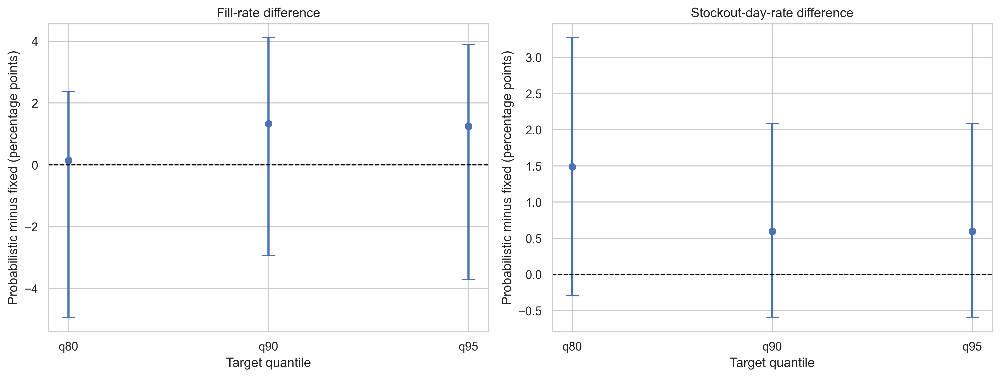

# Final project summary

## Research question

> Under stated replenishment assumptions, can probabilistic forecasts reduce simulated stockouts or inventory held compared with a simple forecasting and fixed-buffer approach?

The final evaluation compares a series-specific probabilistic buffer with a fixed additive buffer on the reserved 28-day period. Both policies receive the same average protection buffer at each target quantile.

## Final policy results

| Target | Policy | Fill rate | Stockout-day rate | Unmet units | Average ending inventory |
|---|---|---:|---:|---:|---:|
| 80% | Fixed | 95.48% | 1.79% | 156 | 57.90 |
| 80% | Probabilistic | 95.63% | 3.27% | 151 | 57.67 |
| 90% | Fixed | 96.55% | 1.49% | 119 | 70.40 |
| 90% | Probabilistic | 97.89% | 2.08% | 73 | 68.99 |
| 95% | Fixed | 97.13% | 1.19% | 99 | 77.51 |
| 95% | Probabilistic | 98.38% | 1.79% | 56 | 76.40 |

At the 90% and 95% targets, the probabilistic policy has higher fill rate, fewer unmet units, and slightly lower average ending inventory. These point estimates support better allocation of the same average buffer.

The stockout-day rate moves in the opposite direction. The probabilistic policy experiences more stockout days but fewer total unmet units. It avoids some large shortages while allowing more small shortages. The preferred policy therefore depends on whether the decision maker prioritizes unit fill rate or the frequency of any shortage.

## Statistical comparison

| Target | Fill-rate difference | 95% interval | Ending-inventory difference | 95% interval |
|---|---:|---:|---:|---:|
| 80% | +0.15 points | -4.93 to 2.36 | -0.23 units | -11.11 to 16.63 |
| 90% | +1.33 points | -2.94 to 4.11 | -1.41 units | -18.27 to 19.70 |
| 95% | +1.25 points | -3.70 to 3.89 | -1.11 units | -21.54 to 24.93 |

Every interval includes zero. The final period gives suggestive evidence in favor of the probabilistic policy at higher targets, but not a statistically clear average advantage across the selected series.

## Profile-level interpretation

- Stable series benefit most from probabilistic allocation. At the 95% target, their fill rate increases from 95.90% to 99.79%.
- Intermittent series achieve 100% fill under both policies, while the probabilistic policy uses much less ending inventory.
- Weekly-pattern series show similar service under both policies at the higher targets.
- Variable series perform worse under the probabilistic policy in this final period, showing that historical empirical quantiles are not automatically reliable for every demand pattern.

## Final conclusion

The project does not find a universal winner. The probabilistic policy improves unit-based service and slightly reduces average inventory at the 90% and 95% targets, but uncertainty intervals are wide and stockout-day frequency is higher. Results vary by demand profile.

The defensible conclusion is that series-specific empirical uncertainty can improve how a shared inventory buffer is allocated, especially for stable and intermittent series, but the evidence from 12 purposively selected series and one 28-day final period is not strong enough for a broad Walmart recommendation.

## Limitations

- Recorded sales are not unconstrained customer demand.
- Stockouts and inventory are simulated rather than observed.
- Lead time and review interval are project assumptions.
- The selected series are not a random sample.
- Bootstrap intervals describe the selected-series evidence, not all M5 products.
- The final period is short and contains only four weekly review cycles.
- Price, events, and SNAP variables are not used in the baseline forecasts.
