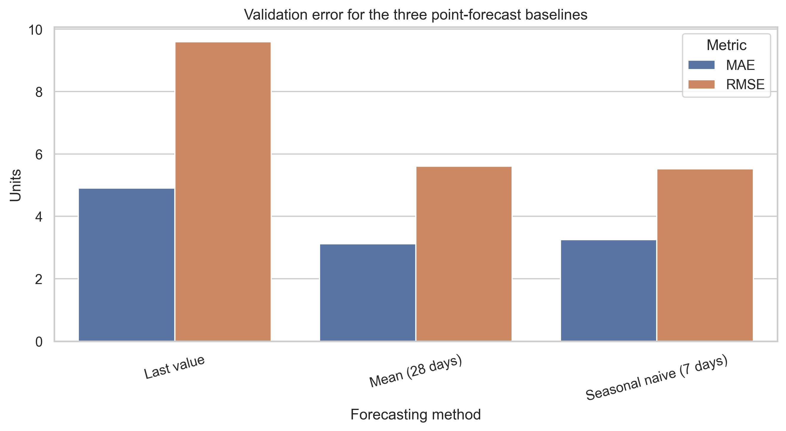
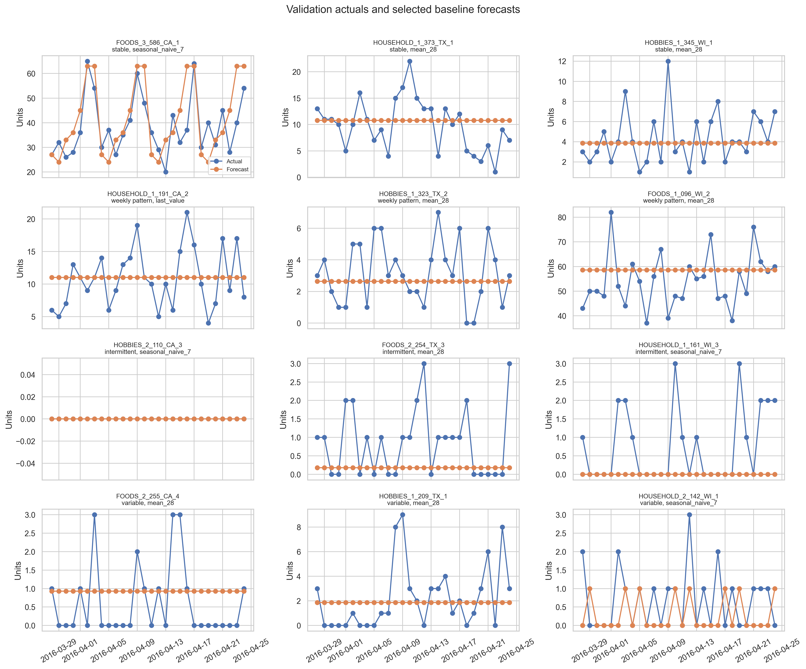

# Point-forecast validation summary

Notebook 04 compared three fixed-origin baselines over the 28-day validation period. It generated 1,008 predictions: 12 series, three models, and 28 days.

## Overall results

| Model | MAE | RMSE | WAPE |
|---|---:|---:|---:|
| Mean of final 28 days | 3.121 | 5.604 | 29.736% |
| Seasonal naive, 7 days | 3.250 | 5.525 | 30.970% |
| Last value | 4.905 | 9.592 | 46.739% |

The 28-day mean has the lowest overall MAE and WAPE, while the seven-day seasonal naive method has the lowest RMSE. The difference confirms that one metric does not capture every aspect of forecast error.

## Per-series selection

Using the lowest MAE for each series selected:

- the 28-day mean for 7 series;
- seasonal naive for 4 series; and
- last value for 1 series.

The selection is series-specific because the demand profiles behave differently. One intermittent series, `HOBBIES_2_110_CA_3`, had zero actual sales throughout validation. Its zero seasonal-naive forecast therefore has MAE and RMSE of zero, while WAPE is undefined because total actual sales are zero.

## Interpretation

These baselines establish a transparent point-forecast foundation. Their role is to support the uncertainty and inventory analysis, not to claim state-of-the-art M5 accuracy. The final 28-day test period remains unused.
