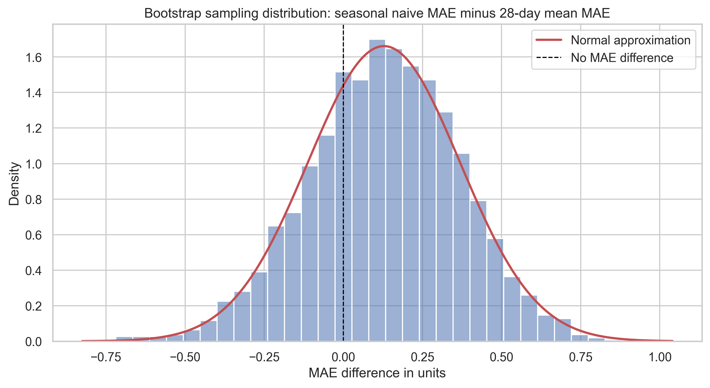
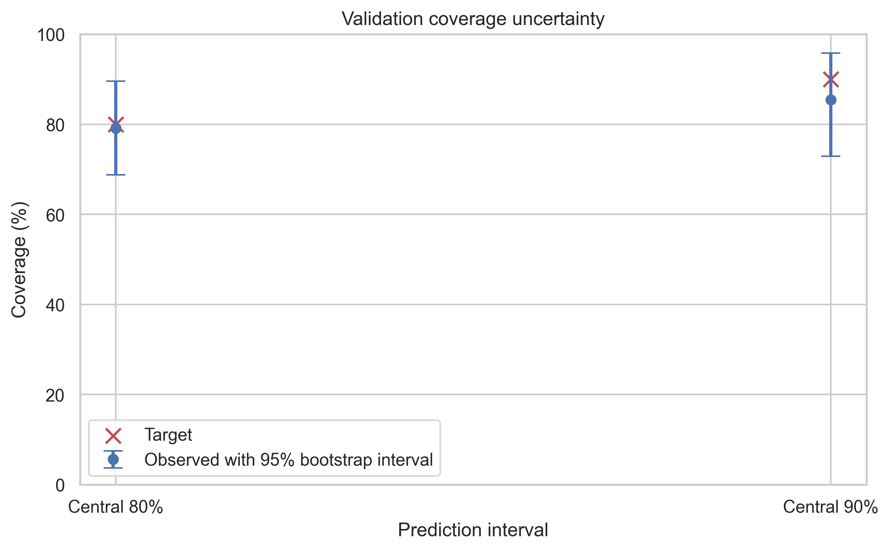
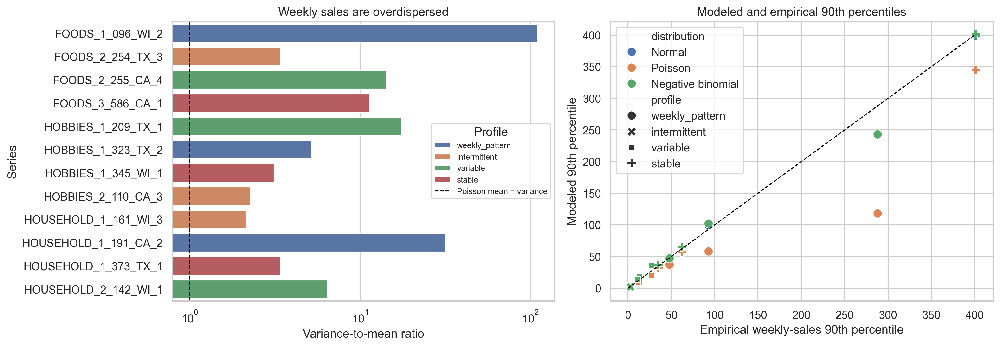

# Statistical inference summary

## Forecast-model uncertainty

| Comparison | Estimate | 95% cluster-bootstrap interval |
|---|---:|---:|
| Last-value MAE | 4.905 | 1.768 to 9.289 |
| Seasonal-naive MAE | 3.250 | 1.717 to 5.081 |
| 28-day-mean MAE | 3.121 | 1.500 to 5.021 |
| Seasonal naive minus 28-day mean | 0.129 | -0.357 to 0.587 |
| Last value minus 28-day mean | 1.784 | -0.121 to 4.682 |

The 28-day mean has the lowest observed MAE, but both paired difference intervals include zero. The project can report the observed ranking without claiming a statistically clear average advantage across the selected series.

## Coverage uncertainty

| Interval | Observed coverage | 95% cluster-bootstrap interval |
|---|---:|---:|
| Central 80% | 79.17% | 68.75% to 89.58% |
| Central 90% | 85.42% | 72.92% to 95.83% |

The 90% point estimate undercovers, but only 48 validation outcomes are available. The interval communicates that imprecision.

## Distribution findings

Every selected series has weekly variance greater than weekly mean. The basic Poisson assumption is therefore not supported. Normal and negative-binomial quantiles provide useful comparisons, while empirical forecast errors remain the primary uncertainty model.

## Protection period

The inventory policy uses a 7-day review interval and a 7-day lead time, requiring a 14-day protection period. Notebook 06 recalibrates the error quantiles at that horizon using training data only.
