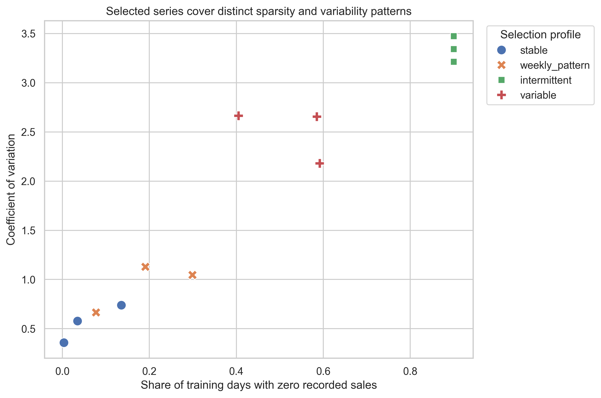
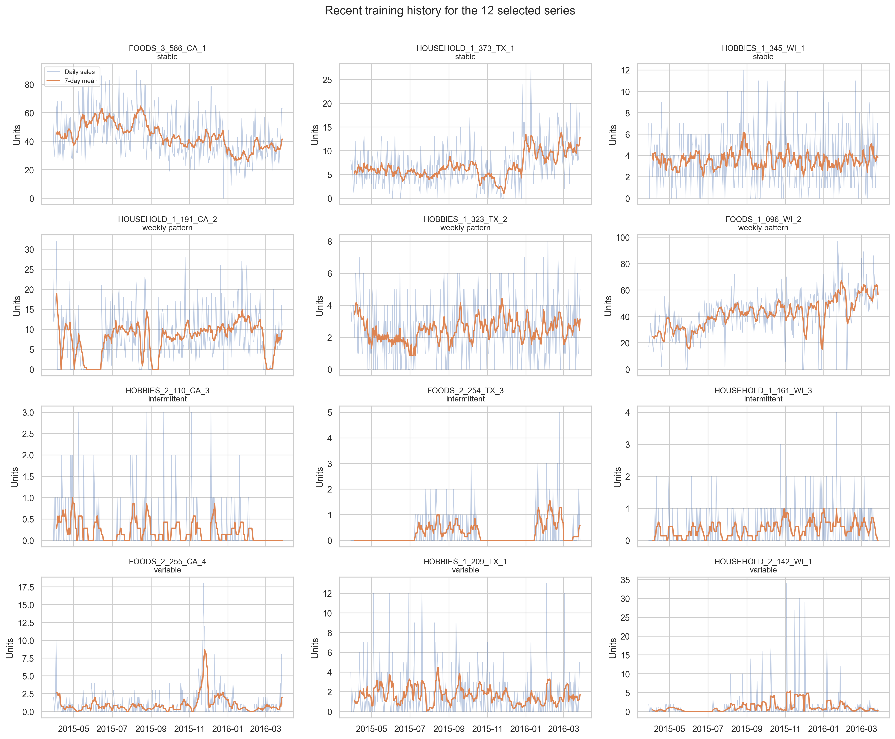
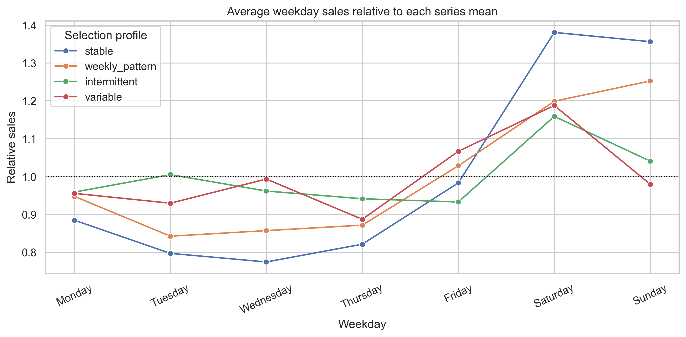
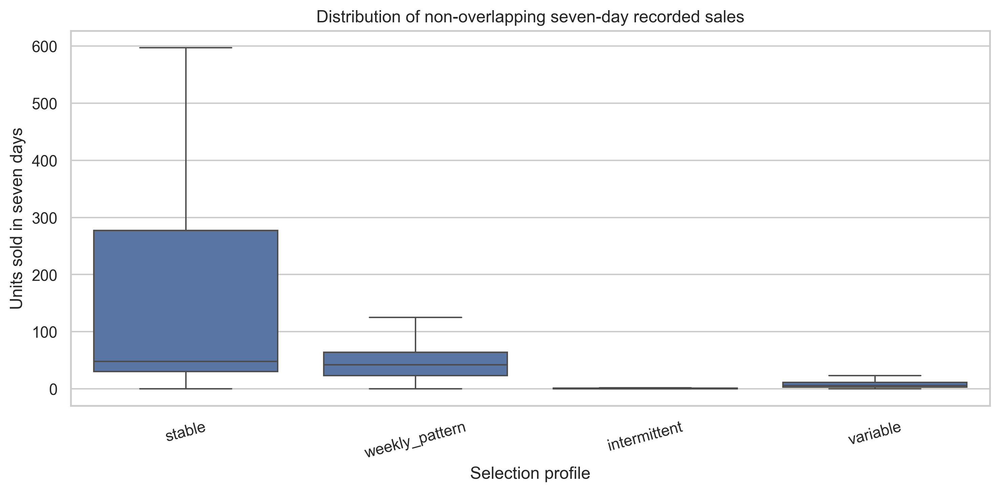

# Time-series EDA summary

Notebook 03 examines the selected series using only the training period, `d_1` through `d_1885`. Validation data are reserved for model comparison.

## Demand profiles

The selection rules produced meaningfully different demand patterns. The stable group has a median zero-sales share of 3.5% and a median coefficient of variation of 0.578. The intermittent group has a 90% median zero-sales share and a median coefficient of variation of 3.343. The variable group has the highest median coefficient of variation at 2.655.

## Time dependence

The weekly-pattern group has the strongest repeated timing. Its median autocorrelation is 0.663 at lag 7, 0.602 at lag 14, and 0.497 at lag 28. This supports including a seven-day seasonal baseline in the forecasting comparison.

All four profiles have higher average relative recorded sales on Saturday than on a typical day. Stable series show the largest Saturday increase, with relative sales of 1.381. This is descriptive evidence and does not establish why the weekday pattern occurs.

## Seven-day demand

Median recorded sales over seven days are 48 units for stable series, 42 for weekly-pattern series, 6 for variable series, and 0 for intermittent series. Intermittent series still average 0.94 units because occasional nonzero weeks raise the mean.

## Implications and limitations

- A single forecasting rule is unlikely to fit all four profiles equally well.
- Weekly lags are plausible for the weekly-pattern group, while intermittent series need careful treatment of long zero runs.
- Price and event relationships are descriptive; no causal effects are estimated.
- Seven-day totals are examined as a useful planning scale. The seven-day lead time used later is a project assumption, not an M5 field.
