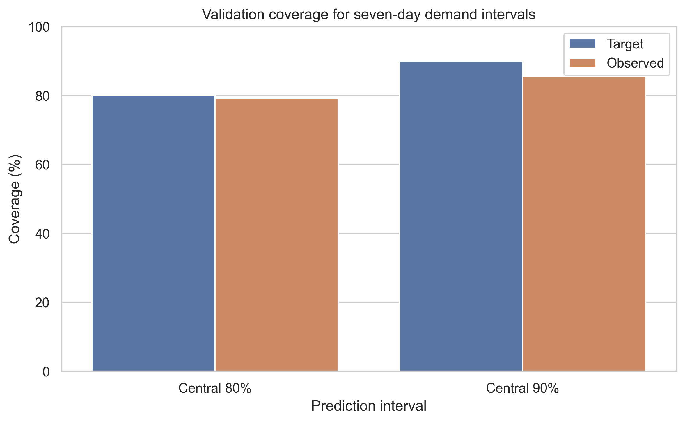
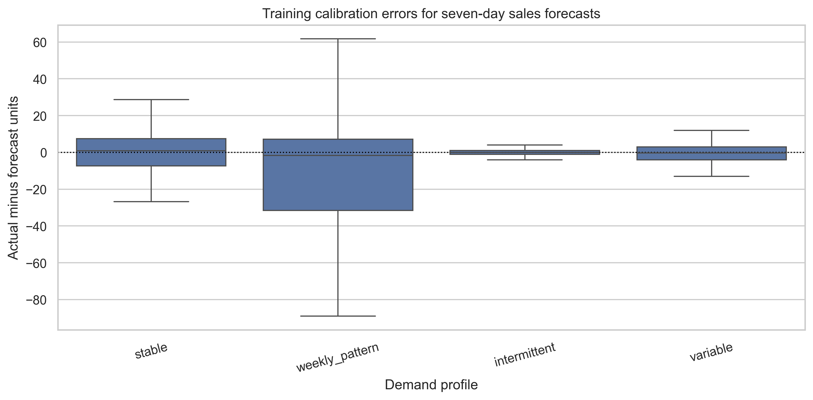
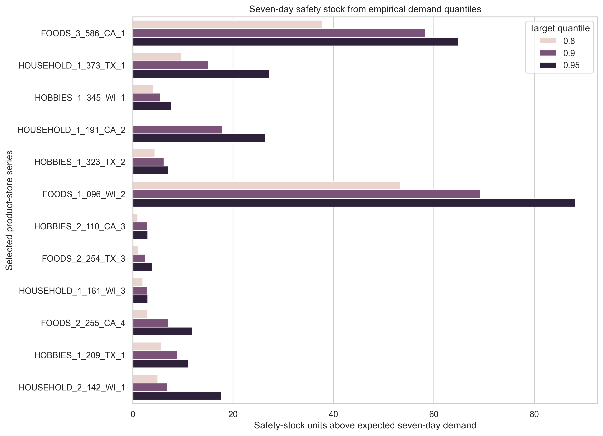

# Uncertainty and safety-stock summary

Notebook 05 uses empirical seven-day forecast errors to describe uncertainty around the selected point forecasts. Calibration uses 52 weekly origins for each of the 12 series, producing 624 error observations.

## Validation results

| Interval | Target coverage | Observed coverage | Mean width |
|---|---:|---:|---:|
| Central 80% | 80.00% | 79.17% | 34.81 units |
| Central 90% | 90.00% | 85.42% | 45.42 units |

The central 80% interval is close to its target. The central 90% interval undercovers by 4.58 percentage points, so it should not be described as fully calibrated. Only 48 weekly validation outcomes are available, which also makes the coverage estimates uncertain.

Mean validation pinball loss is 3.500 at the 80th percentile, 2.278 at the 90th percentile, and 1.474 at the 95th percentile. Values at different quantiles should not be interpreted as a simple ranking of service policies because the loss function changes with the quantile.

## Safety-stock planning levels

The notebook calculates buffers for the next seven days after `d_1913`. Each buffer equals the nonnegative empirical upper forecast-error quantile for that series.

For example, `FOODS_1_096_WI_2` has expected seven-day demand of 379.5 units. Its safety-stock values are 53.40, 69.30, and 88.21 units at the 80th, 90th, and 95th percentiles. Higher quantiles generally create larger buffers, but the increase depends on each series' error distribution.

## Limitations

- The seven-day lead time and weekly review frequency are project assumptions.
- The calibration sample is small and gives each series only 52 historical weekly errors.
- The estimates assume recent historical errors are informative about the next period.
- Safety stock is a planning input, not an observed Walmart decision.
- These are preliminary seven-day buffers. Notebook 06 recalibrates uncertainty for the 14-day protection period, and notebook 07 reports simulated service, shortage, and inventory outcomes under explicit assumptions.
